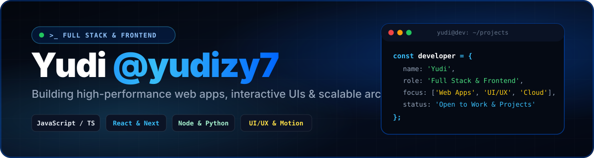

##  >_ Ah, Hello!

Que bom que você chegou até aqui... *(estava esperando a sua visita.)*

Eu sou o **Yudi**, um **Desenvolvedor Full Stack & Front-End** brasileiro apaixonado por interfaces rápidas, engenharia de software moderna e aplicações que resolvem problemas reais no mundo físico e digital. Comecei explorando como transformar código HTML, CSS e JavaScript em experiências visuais fluidas — e hoje construo sistemas web completos, arquiteturas Mobile-First e ferramentas interativas em produção.

Atualmente estou **aberto a oportunidades como Desenvolvedor (Front-End / Full Stack)** e também lidero meus próprios projetos web de alta conversão.

## >_ About Me & Stack

* **Full Stack & Front-End Web Developer** — Foco em JavaScript (ES6+), TypeScript, React, Node.js e Python
* **UI/UX & Mobile-First Engineering** — Interfaces responsivas, Motion Design, CSS Grid/Flexbox e performance (`Core Web Vitals`)
* **Cloud & Deploy Automation** — Netlify CI/CD, Git/GitHub Workflows, REST APIs e integrações em tempo real
* **Founder @ [Yudi Sites](https://yudisites.netlify.app/)** — Estúdio independente com **+13 aplicações web comerciais** publicadas em produção
* **Open to Work** — Disponível para vagas Remotas, Híbridas ou Presenciais (Belém, PA - Brasil)

## 🚀 >_ Softwares & Aplicações em Produção

<table>
  <tr>
    <td align="center" width="33%">
      
       
      <a href="https://yudisites.netlify.app/"><b>Yudi Sites — Web Ecosystem</b></a>
       
      plataforma interativa com simulador multi-device e +13 web apps
    </td>
    <td align="center" width="33%">
      
       
      <a href="https://yudisites.netlify.app/sites/kiip-belem/"><b>KIIP Belém® — Catálogo & Checkout</b></a>
       
      aplicação real com carrinho dinâmico, status em tempo real e Maps
    </td>
    <td align="center" width="33%">
      
       
      <a href="https://yudisites.netlify.app/sites/solaris-energia-solar/"><b>Solaris — Simulador Fotovoltaico</b></a>
       
      cálculo reativo de geração kWh e economia energética anual
    </td>
  </tr>
</table>

## 📱 >_ Interfaces Mobile-First & E-Commerce

<table>
  <tr>
    <td align="center" width="33%">
      
       
      <a href="https://yudisites.netlify.app/sites/brasa-prime-burger/"><b>Brasa Prime — Delivery Web App</b></a>
       
      cardápio digital mobile-first com filtros reativos e checkout direto
    </td>
    <td align="center" width="33%">
      
       
      <a href="https://yudisites.netlify.app/sites/lumina-odonto-prime/"><b>Lumina Odonto — Healthcare UI</b></a>
       
      design system clean médico para agendamento de procedimentos 3D
    </td>
    <td align="center" width="33%">
      
       
      <a href="https://yudisites.netlify.app/sites/primehaus-imoveis/"><b>PrimeHaus — Real Estate Portal</b></a>
       
      vitrine imobiliária de alto padrão com filtros e especificações
    </td>
  </tr>
</table>

## 💻 >_ Repositórios no GitHub

<table>
  <tr>
    <td align="center" width="50%">
      
       
      <a href="https://github.com/yudizy7/yudi-sites-portfolio"><b>yudi-sites-portfolio</b></a>
       
      ⚡ código-fonte do hub interativo e das 13 aplicações web mobile-first
    </td>
    <td align="center" width="50%">
      
       
      <a href="https://github.com/yudizy7/yudizy7"><b>yudizy7 / README</b></a>
       
      🛠️ documentação do meu perfil de desenvolvedor e vitrine técnica
    </td>
  </tr>
</table>

## 📊 >_ Statistics & Social

  

  
  
  
  

